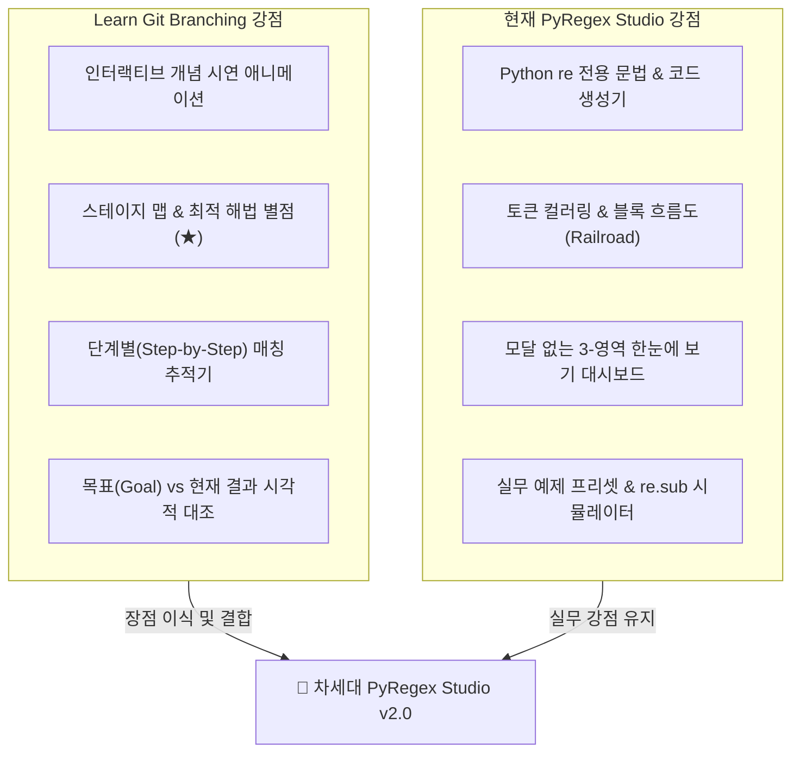

# [벤치마킹 분석 보고서] Learn Git Branching 분석 및 PyRegex Studio 고도화 전략

**분석 대상**: [Learn Git Branching (`learngitbranching.js.org/?locale=ko`)](https://learngitbranching.js.org/?locale=ko)  
**비교 대상**: 현재 프로젝트 **PyRegex Studio** (`c:\Gemini\RegexLearn`)  
**작성 일자**: 2026년 10월 18일  
**작성 목적**: 세계적으로 가장 성공한 개발자 시각적 학습 웹앱 중 하나인 *Learn Git Branching*의 장단점을 심층 분석하고, 이를 현재 정규표현식 학습 앱(`PyRegex Studio`)과 벤치마킹하여 차세대 개선 과제를 도출함.

---

## 1. Learn Git Branching 심층 분석 (장점 vs 단점)

### ✅ 핵심 장점 (Strengths — 우리가 흡수해야 할 요소)

1. **인터랙티브 개념 시연 슬라이드 (`Git Demonstration View`)**
   * 문제를 풀기 전, 단순히 텍스트 설명만 읽게 하는 것이 아니라 **작은 시연 창에서 버튼 클릭 한 번으로 명령어가 동작하는 전/후 애니메이션(`Before → Command 실행 → After / Reset`)**을 직접 눈으로 확인하게 합니다.
   * 학습자가 텍스트를 해독하는 피로도를 줄이고 직관적인 멘탈 모델(Mental Model)을 먼저 형성해 줍니다.

2. **시각적 레벨 맵 & 별점(`★`) 보상 시스템 (`Series & Level Map View`)**
   * 단순 텍스트 목록이 아니라, **코스별 번호 아이콘과 클리어 체크(`✓`), 그리고 최적의 해법으로 풀었을 때 부여하는 별점(`★`)**이 있는 시각적 스테이지 맵을 제공합니다.
   * *"일단 통과(Clear)"*와 *"가장 깔끔하고 짧은 최적의 해법(Golf/Star)"*을 구분하여 다회차 학습 동기를 부여합니다.

3. **단계별 엔진 실행 애니메이션 (Step-by-Step Execution Visualization)**
   * 결과만 정적으로 딱 보여주는 것이 아니라, 엔진이 포인터를 이동하며 처리하는 **중간 과정(Step-by-Step)**을 시각적 애니메이션으로 보여줍니다.

4. **목표 상태 vs 현재 상태의 직관적 시각 비교 (`Goal Comparison`)**
   * 텍스트로만 조건을 설명하지 않고, **"만들어야 할 목표 화면(Goal)"**과 **"내 현재 결과 화면"**을 나란히 시각적으로 대조할 수 있게 해줍니다.

---

### ⚠️ 주요 단점 및 한계 (Weaknesses — 우리가 극복·개선해야 할 요소)

1. **모달(Modal) 중심의 화면 가림 현상**
   * 개념 설명과 미션 안내가 화면 전체를 덮는 팝업 모달로만 제공되어, **문제를 풀면서 개념 설명이나 미션 조건을 동시에 보려면 계속 모달을 여닫아야 하는(`objective`, `show goal`) 불편함**이 있습니다.
2. **추상적 퍼즐에 치우쳐 실무 적용 브릿지(Bridge) 부재**
   * `C1`, `C2` 같은 추상화된 노드 퍼즐로는 훌륭하지만, 학습 후 실제 내 현업 데이터(로그, 텍스트, 코드)에 즉시 적용해 볼 수 있는 **실무 데이터 프리셋이나 실제 코드 스니펫 생성 기능이 없습니다.**
3. **실패 원인(Diff)에 대한 구체적 피드백 부족**
   * 내 결과가 목표와 다를 때 *"왜 틀렸는지(어느 부분에서 과다 매칭되었거나 누락되었는지)"*에 대한 친절한 진단 피드백이 부족합니다.

---

## 2. Learn Git Branching vs PyRegex Studio 벤치마킹 비교표

| 평가 항목 | Learn Git Branching | 현재 PyRegex Studio (v1.0) | 벤치마킹 진단 및 격차 분석 |
| :--- | :---: | :---: | :--- |
| **1. 개념 학습 방식** | ⭐⭐⭐⭐⭐ 슬라이드 + 미니 시연 애니메이션 | ⭐⭐⭐☆ 정적 마크다운 개념 박스 | **[개선 필요]** 텍스트 설명 위주이므로, 클릭 한 번으로 패턴 변화를 보여주는 **미니 인터랙티브 시연 카드** 도입 필요 |
| **2. 엔진 동작 시각화** | ⭐⭐⭐⭐⭐ 커밋/브랜치 이동 애니메이션 | ⭐⭐⭐⭐ 정적 블록 흐름도(Railroad) & 해설 트리 | **[개선 필요]** 정적 구조도뿐만 아니라, 문자열의 첫 글자부터 정규식이 어떻게 전진/백트래킹하는지 보여주는 **Step-by-Step 매칭 디버거(애니메이션)** 추가 시 효과 극대화 |
| **3. 커리큘럼 네비게이션** | ⭐⭐⭐⭐⭐ 메인편/원격편 탭 + 시각적 원형 스테이지 맵 | ⭐⭐⭐☆ 좌측 리스트형 아코디언 메뉴 | **[개선 필요]** 한눈에 정복감을 주는 **시각적 코스 맵(Level Map Modal)** 및 **최적 패턴 별점(`★`) 시스템** 도입 필요 |
| **4. 목표(Goal) 직관성** | ⭐⭐⭐⭐☆ 목표 트리 vs 내 트리 시각 비교 | ⭐⭐⭐☆ 텍스트 체크리스트(`mustMatch`) | **[개선 필요]** 샘플 텍스트 위에서 **"🎯 목표 하이라이트"**와 **"⚡ 내 현재 매칭 하이라이트"**를 한눈에 겹쳐 비교하는 시각적 Goal 뷰 필요 |
| **5. 화면 레이아웃 편의성** | ⭐⭐⭐☆☆ 모달을 계속 여닫아야 함 | ⭐⭐⭐⭐⭐ 3-영역 통합 대시보드 (모달 불필요) | **[현재 우위 유지]** 설명·시각화·실습을 한 화면에서 보는 현재 대시보드 구조를 유지하되, 원할 때만 열리는 시연/맵 뷰 결합 |
| **6. 실무 연계성 & 확장성** | ⭐⭐☆☆☆ 퍼즐에 한정됨 | ⭐⭐⭐⭐⭐ 실무 프리셋, `re.sub`, Python 코드 생성 | **[현재 우위 유지]** 현업 활용을 위한 Python 코드 생성기, 북마크, 실무 로그/마스킹 프리셋은 현재 앱의 독보적 강점 |

---

## 3. 벤치마킹 기반 PyRegex Studio 4대 핵심 개선 제안 (v2.0 로드맵)

*Learn Git Branching*의 몰입감 넘치는 학습 경험(UX)을 현재 프로젝트에 이식하기 위해 다음 **4가지 핵심 업그레이드**를 제안합니다.

### 제안 ①: [Step-by-Step 매칭 트레이서 (애니메이션 디버거)] 도입 🔥 *(최우선 추천)*
* **기존**: 정규식을 입력하면 매칭된 최종 결과만 즉시 하이라이트됨.
* **개선**: *Learn Git Branching*의 애니메이션처럼 **`[⏮ 처음] [◀ 이전 스텝] [▶ 재생/일시정지] [다음 스텝 ▶]`** 컨트롤러를 추가합니다.
  * 정규식 엔진 포인터가 테스트 문자열의 0번 인덱스부터 한 글자씩 이동하며 **현재 어느 정규식 토큰이 검사 중인지, 어디서 매칭에 성공/실패하고 백트래킹(되감기)이 일어나는지** 시각적 애니메이션으로 보여줍니다.
  * 특히 Greedy(`.+`) vs Lazy(`.+?`)나 전방탐색(`(?=...)`)의 동작 원리를 눈으로 이해하는 데 결정적인 역할을 합니다.

### 제안 ②: [인터랙티브 개념 시연(Demo) 슬라이드] 탑재
* **기존**: 각 레슨 좌측 상단에 줄글(텍스트)로만 개념이 설명되어 있음.
* **개선**: *Learn Git Branching*의 `Git Demonstration View`를 벤치마킹하여, 레슨 개념 영역에 **[▶ 시연 보기: Before / After 비교]** 인터랙티브 위젯을 추가합니다.
  * 예: Lv 2-3(Greedy vs Lazy) 진입 시, 버튼 하나로 `<b>.+</b>`가 문장 전체를 삼키는 모습과 `<b>.+?</b>`가 태그별로 끊어 읽는 모습을 즉시 애니메이션으로 비교 시연합니다.

### 제안 ③: [시각적 목표(Goal) 하이라이트 비교 뷰]
* **기존**: 하단 체크리스트에 `매칭 필수: "app.py"`처럼 텍스트로만 성공 여부를 표시.
* **개선**: 테스트 문자열 뷰어에서 **[🎯 목표 매칭 영역(초록 점선 테두리)]**과 **[⚡ 내 정규식이 현재 매칭한 영역(배경 하이라이트)]**을 동시에 표시합니다.
  * 어디가 덜 매칭되었는지(미달), 어디가 실수로 더 매칭되었는지(오탐) 텍스트 위에서 1초 만에 직관적으로 파악할 수 있습니다.

### 제안 ④: [시각적 스테이지 맵 & 최적 해법 별점(`★`) 시스템]
* **기존**: 단순 완료 체크(`✓`)만 존재.
* **개선**:
  * 상단에 *Learn Git Branching* 스타일의 **[🗺️ 전체 코스 맵]** 버튼을 추가하여 Lv 1 ~ Lv 5의 진행도를 게임 월드맵처럼 한눈에 보여줍니다.
  * 미션을 그냥 통과하면 **일반 클리어(`✓`)**, 불필요한 중복 없이 권장 패턴 길이(Par) 이내이거나 백트래킹 경고 없이 깔끔하게 풀면 **마스터 별점(`★`)**을 부여하여 성취감을 극대화합니다.

---

## 4. 검토 및 향후 진행 의견 요청

위 4가지 벤치마킹 개선안(**① Step-by-Step 매칭 애니메이션 트레이서, ② 인터랙티브 개념 시연 위젯, ③ 시각적 목표(Goal) 하이라이트 비교, ④ 스테이지 맵 & 별점(`★`) 시스템**) 중에서:
* **전체 반영**하여 고도화를 진행할지,
* 혹은 **특정 기능(예: ① + ③ 등)을 우선 선택**하여 반영할지 검토 의견을 주시면 즉시 구현을 진행하겠습니다!
