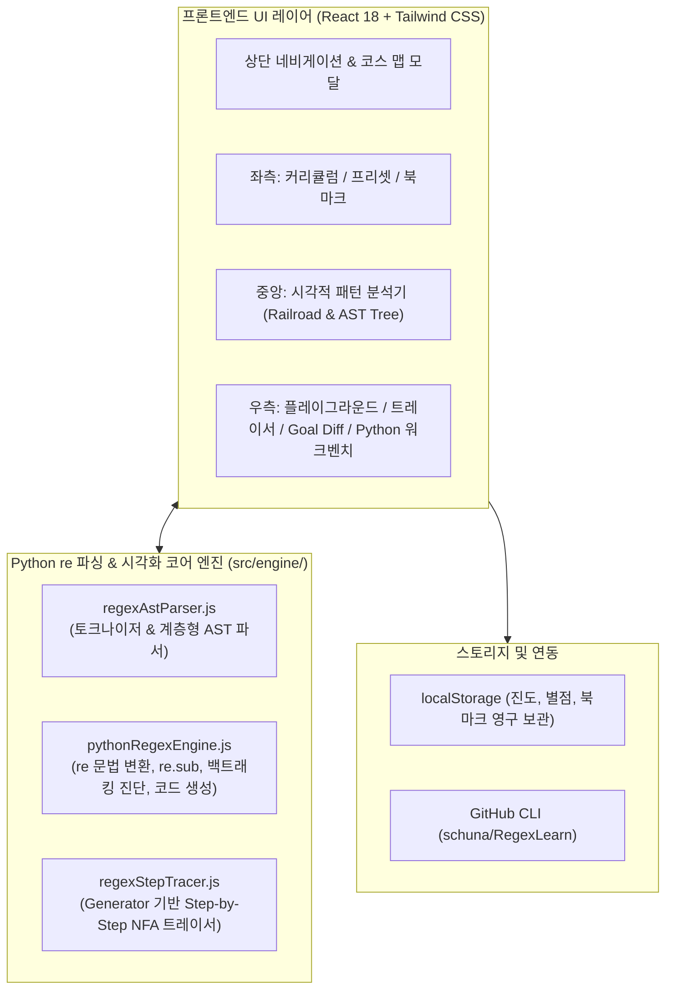

# [최종 보고서] PyRegex Studio 개발 완료 보고서

**프로젝트명**: PyRegex Studio (Python `re` 특화 정규표현식 시각적 학습 & 실습 웹 애플리케이션)  
**작성일자**: 2026년 10월 21일  
**작성자**: Antigravity Pair Programmer  
**저장소**: [https://github.com/schuna/RegexLearn](https://github.com/schuna/RegexLearn)  
**프로젝트 위치**: `c:\Gemini\RegexLearn`  

---

## 1. 프로젝트 개요 및 추진 배경

### 1.1 배경 및 목적
* **업무 현업 애로사항**: Python `re` 모듈을 업무에서 사용 중이나, 기초 수준(단순 문자열 검색, 고정 패턴)에 머물러 복잡한 데이터 파싱 및 정제 작업에 한계가 존재함.
* **학습 목표**: 
  1. 메타문자 및 수량자 기초부터 명명된 그룹(`(?P<name>...)`), 전방/후방 탐색(Lookaround), 역참조 치환(`re.sub`), 백트래킹(Backtracking) 최적화까지 체계적 실무 역량 배양.
  2. 추상적이고 난해한 정규식 매칭 흐름을 직관적인 **시각적 다이어그램(Railroad View) 및 Step-by-Step 애니메이션**으로 시각화하여 오개념 방지.
  3. 학습 직후 현업 코드에 즉시 붙여넣을 수 있는 **Python 3 `re` 표준 코드 자동 생성 및 실무 가상 데이터 프리셋** 연계.

### 1.2 주요 추진 경과
1. **기획 및 아키텍처 확정 (Phase 0)**: 사용자 피드백을 수렴하여 Vite + React 기반 3-영역 대시보드 구축 확정.
2. **v1.0 코어 엔진 및 실습 환경 구축 (Phase 1 ~ 4)**: Python `re` AST 파서, 플레이그라운드, 5단계 커리큘럼, 실무 프리셋 구현.
3. **GitHub CLI 자동화 및 멀티 PC 동기화 가이드 수립**: `gh` CLI 기반 저장소 자동 생성, 커밋/푸시 및 구글 드라이브 연동 아키텍처 정리.
4. **Learn Git Branching 벤치마킹 및 v2.0 메이저 고도화**:
   * Step-by-Step 매칭 트레이서(디버거)
   * 인터랙티브 개념 시연 위젯(Before/After)
   * 시각적 목표(Goal) Diff 비교 뷰어
   * 스테이지 월드맵 및 마스터 별점(`★`) 보상 체계

---

## 2. 시스템 아키텍처 및 기술 스택



* **Frontend Framework**: React 18, Vite (Node 14 호환 환경, 기본 포트 `5188`)
* **Styling & Icons**: Tailwind CSS 3.3, Lucide React Icons
* **Core Engine**:
  * 커스텀 Python `re` 정규식 트랜스파일러 & AST 파서
  * JavaScript Generator(`function*`) 기반 NFA Step-by-Step 실행 트레이서
  * 백트래킹 위험도 판별 알고리즘 및 정량적 별점 평가 엔진
* **데이터 관리**: 브라우저 `localStorage` 기반 상태 지속성 (진도율, 별점, 개인 북마크)

---

## 3. 핵심 기능 구현 결과 (6대 컴포넌트)

| No | 기능명 | 핵심 구현 내용 및 화면 역할 | 담당 컴포넌트 |
| :---: | :--- | :--- | :--- |
| **1** | **시각적 패턴 분석기<br>(Visual Explainer)** | • 정규식 토큰 분해 및 9가지 범주별 컬러 코딩<br>• 좌→우 평가 흐름을 나타내는 **블록 흐름도(Railroad View)**<br>• 계층형 한국어 자연어 해설 트리<br>• 트레이서 실행 시 현재 검사 중인 토큰 실시간 하이라이트 | `VisualPatternAnalyzer.jsx` |
| **2** | **Step-by-Step 매칭 트레이서<br>(애니메이션 디버거)** | • 스텝별 전진(`advance`), 조건 검사(`check`), 실패(`fail`), **백트래킹(`backtrack`)** 시각화<br>• Zero-width(`^`, `$`, `\b`, `(?=...)`) 전용 **I-beam(`\|`) 커서** 렌더링<br>• $O(1)$ 슬라이더, 속도 조절(`0.5x~4x`), 키보드 단축키(`←`, `→`, `Space`)<br>• 최대 1,000스텝 상한선 기반 재앙적 백트래킹 경고 | `StepByStepTracer.jsx`<br>`regexStepTracer.js` |
| **3** | **시각적 목표(Goal) Diff 뷰** | • 🎯 목표 영역(초록 점선) vs ⚡ 내 매칭(배경색) 이중 오버레이 대조<br>• 자동 진단 매트릭스: 과다 매칭(`Over-matching`), 부분 매칭(`Under-matching`), 오탐(`Mismatch`) 원인 실시간 조언 | `GoalDiffViewer.jsx` |
| **4** | **인터랙티브 개념 시연 위젯** | • 각 강의 상단에서 흔한 실수(`Before`)와 정석 패턴(`After`)의 엔진 동작 차이를 미니 애니메이션 플레이어로 즉시 비교 시연 | `ConceptDemoWidget.jsx` |
| **5** | **실시간 플레이그라운드 & 실무 도구** | • Python 고유 문법 완벽 호환 (`(?P<name>...)`, `\g<name>`, `re.I/M/S/X`)<br>• 매칭 상세 테이블 (`group(0)`, `groups()`, `groupdict()`, `span()`)<br>• `re.sub` 역참조 치환 시뮬레이터 (Before/After 프리뷰)<br>• 1클릭 복사 가능한 실무 Python `re` 코드 자동 생성기 | `PlaygroundPanel.jsx`<br>`pythonRegexEngine.js` |
| **6** | **5단계 커리큘럼 & 스테이지 월드맵** | • Lv 1 (기초) ~ Lv 5 (실무 마스터) 총 16개 실습 레슨<br>• **마스터 별점(`★`) 보상 체계**: 미션 통과 + 권장 길이(`Par`) + 최소 스텝 충족 시 획득<br>• *Learn Git Branching* 스타일 스테이지 월드맵 모달<br>• 미션 클리어 시 완성된 Python 코드 즉시 복사 연동 | `CurriculumSidebar.jsx`<br>`StageMapModal.jsx`<br>`curriculumData.js` |

---

## 4. 커리큘럼 및 실무 프리셋 구성 현황

### 4.1 5단계 실습 커리큘럼 (총 16개 핵심 강의)
* **Lv 1. 기초 다지기**: 와일드카드(`.`)와 이스케이프(`\.`), 단축 문자 클래스(`\d`, `\w`, `\s`), 대괄호 집합(`[...]`, `[^...]`)
* **Lv 2. 수량자와 앵커**: 기본 수량자(`*`, `+`, `?`), 정밀 수량자(`{n,m}`), **탐욕적(Greedy) vs 게으른(Lazy `*?`, `+?`) 매칭**, 단어 경계(`\b`)
* **Lv 3. 그룹과 캡처 (실무 핵심)**: 캡처 그룹(`(...)`), 비캡처 그룹(`(?:...)`), **Python 명명된 그룹(`(?P<name>...)`)**, 역참조(`\1`, `(?P=name)`)
* **Lv 4. 전방/후방 탐색 (Lookaround)**: 긍정 전방탐색(`(?=...)`), 긍정 후방탐색(`(?<=...)`), 부정 탐색(`(?!...)`, `(?<!...)`)
* **Lv 5. 실무 마스터 & 성능 최적화**: `re.sub` 개인정보 마스킹, `re.X` (`VERBOSE`) 주석 모드, **백트래킹 원리 및 성능 최적화 실습**

### 4.2 3대 핵심 실무 가상 데이터 프리셋
1. **시스템/서버 로그 분석**: WAS 애플리케이션 에러 로그 구조화 파싱, Nginx Access Log 상태코드/응답시간 추출, Python Traceback 에러 위치 파싱
2. **개인정보 및 보안 마스킹**: 주민등록번호 뒷자리 비식별화(`\g<birth>-\g<gender>******`), 이메일 아이디 부분 마스킹(`\g<prefix>***@\g<domain>`)
3. **텍스트 추출 및 정제**: HTML/XML 짝꿍 태그 내부 콘텐츠 추출, 따옴표 포함 CSV 정밀 파싱, `re.X` 사내 설비 시리얼 번호 규격 검증

---

## 5. 최종 산출물 및 문서 목록

```text
RegexLearn/
├── index.html                               # HTML 엔트리 포인트
├── package.json                             # 프로젝트 의존성 및 스크립트 정의
├── vite.config.js                           # Vite 설정 (포트 5188)
├── tailwind.config.js                       # Tailwind CSS 테마 설정
├── README.md                                # [문서] v2.0 공식 사용 가이드
├── AGENTS.md                                # [규칙] 에이전트 작업 환경 및 Git 설정 규칙
├── ANTIGRAVITY_SYNC_GUIDE.md                # [가이드] 멀티 PC 동기화 및 GitHub/구글 드라이브 연동 안내서
├── BENCHMARK_REPORT.md                      # [보고서] Learn Git Branching 벤치마킹 분석 보고서
├── v2_implementation_plan.md               # [기획서] v2.0 상세 설계서 및 로드맵
├── pyregex_studio_v2_0.md                   # [리뷰] 개발팀 기술 검토 피드백
├── FINAL_DEVELOPMENT_REPORT.md              # [본 문서] 최종 개발 완료 보고서
├── .agents/skills/github-sync/SKILL.md      # [스킬] GitHub CLI 동기화 자동화 워크플로우
└── src/
    ├── App.jsx                              # 메인 대시보드 및 상태 오케스트레이션
    ├── main.jsx                             # React DOM 렌더러
    ├── index.css                            # 전역 스타일
    ├── engine/
    │   ├── pythonRegexEngine.js             # Python re 트랜스파일러, re.sub, 백트래킹 분석
    │   ├── regexAstParser.js                # 정규식 토크나이저 & 계층형 AST 파서
    │   └── regexStepTracer.js               # Generator 기반 Step-by-Step 매칭 트레이서
    ├── components/
    │   ├── VisualPatternAnalyzer.jsx        # 토큰 컬러링, 블록 흐름도, 해설 트리
    │   ├── StepByStepTracer.jsx             # 트레이서 플레이어 & 디버거 UI
    │   ├── GoalDiffViewer.jsx               # 시각적 Goal Diff 오버레이 뷰어
    │   ├── ConceptDemoWidget.jsx            # Before/After 인터랙티브 개념 시연 위젯
    │   ├── StageMapModal.jsx                # 스테이지 월드맵 & 별점 모달
    │   ├── PlaygroundPanel.jsx              # 플레이그라운드, Edit/Trace 모드 전환
    │   ├── CurriculumSidebar.jsx            # 커리큘럼 가이드, 별점 판정, Python 코드 복사
    │   ├── PresetsSidebar.jsx               # 실무 프리셋 사이드바
    │   ├── BookmarksSidebar.jsx             # 나만의 북마크 보관함
    │   └── CheatsheetModal.jsx              # Python re 인터랙티브 치트시트
    └── data/
        ├── curriculumData.js                # 5단계 커리큘럼 데이터
        ├── presetsData.js                   # 실무 가상 데이터 프리셋
        └── cheatsheetData.js                # 치트시트 항목 데이터
```

---

## 6. Git 커밋 이력 요약

| 커밋 해시 | 커밋 메시지 | 주요 작업 내용 |
| :---: | :--- | :--- |
| `be3ff26` | `feat: Python re 시각적 학습 웹 앱 초기 구현` | v1.0 코어 엔진, UI, 커리큘럼, 프리셋 전체 구축 |
| `2871220` | `docs: 프로젝트 소개 및 사용 가이드 README.md 추가` | v1.0 README 작성 및 저장소 푸시 |
| `c7ebec2` | `chore: Antigravity 규칙 및 github-sync 스킬 추가` | `AGENTS.md` 및 `.agents/skills/` 등록 |
| `c1e7275` | `docs: Antigravity 멀티 PC 동기화 가이드 추가` | 멀티 PC 동기화 전략 문서화 |
| `9c7965f` | `feat(v2-phase1): Step-by-Step 매칭 트레이서 엔진 구현` | v2.0 트레이서 코어 및 디버거 UI 구축 |
| `ed8ef41` | `feat(v2-phase2): 시각적 목표 Diff 뷰 & 시연 위젯 구현` | Goal Diff 오버레이 및 Before/After 미니 플레이어 |
| `ed81f67` | `feat(v2-phase3): 스테이지 월드맵 및 별점(★) 시스템 구현` | 월드맵 모달, 정량적 별점 판정, Python 코드 즉시 복사 |
| `41548fd` | `docs(v2-phase4): README 업데이트 및 전체 통합 빌드 검증` | v2.0 공식 문서화 및 최종 원격 푸시 완료 |

---

## 7. 실행 및 활용 안내

터미널에서 아래 명령어로 즉시 로컬 실행이 가능합니다.

```powershell
cd c:\Gemini\RegexLearn
npm run dev
```

* **로컬 웹 접속**: [http://localhost:5188](http://localhost:5188)
* **원격 저장소 확인**: [https://github.com/schuna/RegexLearn](https://github.com/schuna/RegexLearn)
* **멀티 PC 사용**: 다른 PC에서 `git clone` 후 `npm install`을 실행하면 동일한 환경과 에이전트 규칙이 즉시 적용됩니다.
