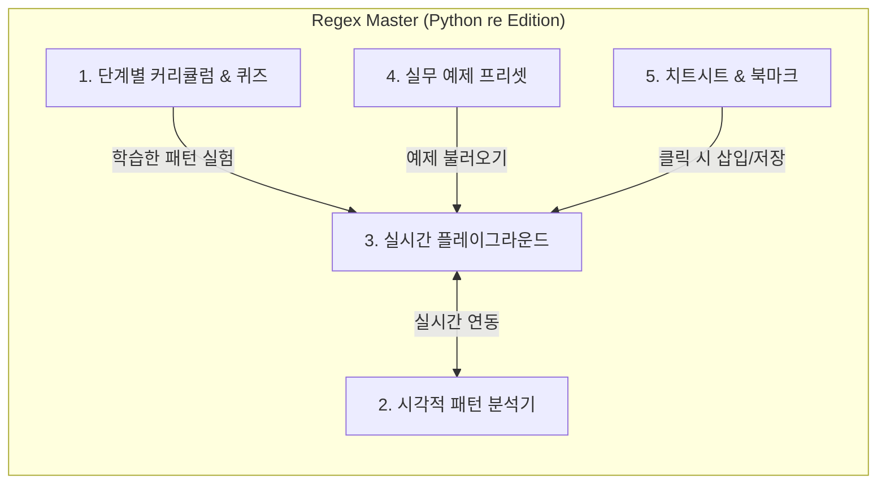

# Python 정규표현식(Regex) 시각적 학습 & 실습 웹 앱 개발 계획서

현재 업무에서 사용 중인 **Python (`re` 모듈)** 정규표현식 활용 능력을 기초부터 고급(그룹핑, 전방/후방 탐색, 치환 등)까지 확장할 수 있도록, **시각적 패턴 분석**과 **인터랙티브 실습**을 결합한 웹 애플리케이션 개발 계획입니다.

---

## 1. 기술 스택 및 아키텍처

설치나 복잡한 서버 구동 없이 브라우저에서 즉시 빠르고 쾌적하게 실행되면서도, **실제 Python `re` 엔진과의 호환성**을 극대화하는 구조로 설계합니다.

* **프론트엔드 프레임워크**: Vite + React (또는 별도 빌드 없이도 바로 열 수 있는 모던 Vanilla JS 모듈 구조 — *검토 후 선택 가능, 기본안은 관리와 확장성이 좋은 로컬 웹앱 또는 단일 실행형 웹앱*)
* **스타일링**: Tailwind CSS (다크/라이트 모드 지원, 토큰/그룹별 컬러 코딩 시각화)
* **정규식 분석 및 실행 엔진**:
  * **실시간 매칭 & 시각화**: 반응속도가 중요한 타이핑 중 하이라이팅은 커스텀 Regex 토크나이저(AST 파서) 및 JS RegExp 변환 레이어 활용 (`(?P<name>...)` 등 Python 고유 문법을 JS `(?<name>...)` 및 `re` 동작 방식에 맞게 매핑)
  * **Python 코드 생성기 (`re` Snippet Generator)**: 작성한 정규식과 플래그(`re.I`, `re.M`, `re.S`, `re.X`)를 바탕으로 업무에 바로 복사해 쓸 수 있는 Python 코드(`re.search`, `re.findall`, `re.finditer`, `re.sub`, `re.compile`) 자동 생성
* **데이터 저장**: `localStorage` 활용 (학습 진도율, 퀴즈 완료 상태, 나만의 북마크 패턴 영구 보관 및 JSON 내보내기/가져오기 지원)

---

## 2. 5대 핵심 기능 설계

### ① 시각적 패턴 분석기 (Visual Pattern Explainer & Railroad View)
* **토큰별 컬러 하이라이팅**: 입력한 정규식을 문자 클래스(`[a-z]`), 수량자(`+`, `{2,5}`), 앵커(`^`, `\b`), 그룹(`(...)`, `(?P<name>...)`), 탐색(`(?=...)`) 단위로 색상을 구분해 표시합니다.
* **시각적 흐름도 (Visual Flow / Block Diagram)**: 정규식이 왼쪽에서 오른쪽으로 어떻게 매칭되는지 직관적인 블록 다이어그램으로 시각화하여 복잡한 패턴도 한눈에 구조를 파악할 수 있게 합니다.
* **한국어 자연어 해설 트리**: 각 토큰에 마우스를 올리거나 클릭하면 *"1개 이상의 숫자 매칭 (`\d+`)"*, *"'year'라는 이름의 캡처 그룹 (`(?P<year>...)`)"* 과 같이 계층 구조로 쉽게 풀어서 설명합니다.

### ② 실시간 플레이그라운드 (Python `re` Playground)
* **매칭 & 캡처 그룹 하이라이트**: 테스트 문자열에서 전체 매칭(Match) 영역과 하위 캡처 그룹(Group 1, Group 2, Named Group)을 서로 다른 배경색으로 실시간 하이라이트합니다.
* **매칭 상세 테이블**: 각 매칭 건별로 `match.group(0)`, `match.groups()`, `match.groupdict()`, 인덱스(`span()`) 결과를 표 형태로 명확히 보여줍니다.
* **치환(`re.sub`) 시뮬레이터**: `\1`, `\g<name>` 등 Python `re.sub` 역참조 문법을 사용하여 텍스트가 어떻게 변환되는지 실시간 비교(Before / After)합니다.
* **Python 코드 원클릭 복사**: 현재 패턴과 테스트 옵션을 그대로 수행하는 Python `re` 예제 코드를 자동 생성합니다.

### ③ 단계별 인터랙티브 커리큘럼 & 퀴즈 (Step-by-Step Learn)
단순히 아는 문법만 반복 쓰는 습관에서 벗어나도록 **기초 → 중급 → 고급(실무 해방)** 5단계 코스를 제공합니다.
* **실습 문제 풀이 방식**:
  * ✅ **Match 해야 할 텍스트** (초록색 체크)
  * ❌ **Match 하지 말아야 할 텍스트** (빨간색 방어)
  * ✂️ **추출(Group) 또는 치환(Sub) 미션**
  * 단계별 힌트 제공 및 정답 패턴 비교

| 단계 | 주제 | 핵심 학습 내용 (Python `re` 기준) |
| :--- | :--- | :--- |
| **Lv 1. 기초 다지기** | 리터럴, 메타문자, 문자 클래스 | `.`, `\d`, `\w`, `\s`, `[a-z]`, `[^0-9]`, Raw String(`r""`)의 중요성 |
| **Lv 2. 수량자와 앵커** | 반복 매칭과 경계 지정 | `*`, `+`, `?`, `{m,n}`, **탐욕적(Greedy) vs 게으른(Lazy `*?`, `+?`) 매칭**, `^`, `$`, `\b` |
| **Lv 3. 그룹과 캡처 (핵심)** | 부분 추출과 재사용 | 캡처 그룹 `(...)`, 비캡처 그룹 `(?:...)`, **Python 명명된 그룹 `(?P<name>...)`**, 역참조 `\1`, `(?P=name)` |
| **Lv 4. 전방/후방 탐색** | 조건부 매칭 (Lookaround) | 긍정/부정 전방탐색 `(?=...)`, `(?!...)`, 긍정/부정 후방탐색 `(?<=...)`, `(?<!...)` (패턴 소비 없이 경계 찾기) |
| **Lv 5. 실무 마스터** | 치환(`re.sub`)과 성능 최적화 | `re.sub` 역참조 치환 `\g<1>`, 멀티라인/Verbose(`re.X`) 주석 작성법, 백트래킹 주의사항 |

### ④ 실무 예제 프리셋 (Work-Ready Presets)
버튼 하나로 플레이그라운드에 불러와 구조를 분석하고 변형해 볼 수 있는 실무 시나리오 모음입니다.
* **로그/시스템 분석**: 타임스탬프, 로그 레벨(`[ERROR]`), IP 주소, 에러 코드 파싱 (`(?P<ip>...)` 활용)
* **데이터 정제 및 마스킹**: 개인정보(주민번호, 전화번호, 이메일) 부분 마스킹 처리 (`re.sub` 활용)
* **문서/코드 텍스트 추출**: HTML/XML 태그 내부 값 추출(Lazy 수량자 활용), CSV/특수 구분자 파싱, 특정 접두사/접미사 뒤의 값만 추출(Lookaround 활용)

### ⑤ 치트시트 & 나만의 북마크 (Cheatsheet & Snippets)
* **인터랙티브 치트시트**: 사이드바 또는 모달에서 언제든 열람 가능하며, 항목 클릭 시 현재 입력창에 즉시 삽입하거나 예제를 미리 볼 수 있습니다.
* **나만의 패턴 북마크**: 업무 중 자주 쓰는 정규식과 샘플 텍스트, 메모를 저장해 두고 언제든 꺼내 쓸 수 있는 개인 스니펫 보관함입니다.

---

## 3. 화면 구성 (UI 레이아웃)

한 화면에서 학습, 분석, 실습이 끊김 없이 이루어지도록 **3-영역 대시보드 레이아웃**으로 구성합니다.

1. **상단 네비게이션 바**: 모드 전환 탭 (`🎓 단계별 학습`, `🧪 플레이그라운드`, `💼 실무 프리셋`, `⭐ 내 북마크`) + 치트시트 토글 버튼 + 학습 진도율 표시
2. **좌측/상단 패널 (학습 가이드 또는 프리셋 목록)**:
   * 학습 모드일 때: 개념 설명, 시각적 예시, 미션 조건(Match / Skip / Capture 목표) 표시
   * 플레이그라운드 모드일 때: 정규식 입력창, 플래그(`I`, `M`, `S`, `X`) 선택, **시각적 패턴 블록 다이어그램 & 토큰 해설**
3. **우측/하단 패널 (실시간 테스트 & Python 결과)**:
   * 테스트 문자열 하이라이트 에디터
   * 캡처 그룹(`groupdict`, `groups`) 추출 결과 뷰어 / `re.sub` 치환 결과 뷰어 / Python 코드 생성 탭

---

## 4. 개발 진행 순서 (Phases)

* **Phase 1: 프로젝트 초기 세팅 및 정규식 파서/실행 코어 구현**
  * 기본 UI 프레임워크 구성 및 Python `re` 문법 호환 토크나이저(시각적 분석기 엔진) 구현
* **Phase 2: 시각적 패턴 분석기 & 실시간 플레이그라운드 UI 구현**
  * 토큰별 컬러 코딩, 시각적 블록 흐름도, 매칭/그룹 하이라이터, `re.sub` 치환기, Python 코드 생성기 구현
* **Phase 3: 단계별 커리큘럼(Lv 1 ~ Lv 5) 및 인터랙티브 퀴즈 탑재**
  * 15~20개의 핵심 실습 레슨 데이터 구축 및 미션 자동 채점/힌트 시스템 구현
* **Phase 4: 실무 프리셋, 치트시트, 북마크 기능 및 사용성 다듬기**
  * 실무 예제 탑재, 로컬 스토리지 연동(진도 저장 및 북마크), UI/UX 디테일 점검

---

> [!IMPORTANT]
> **검토 요청 사항**
> 1. 앱 실행 방식으로 **① 별도 설치/서버 실행 없이 브라우저에서 `index.html`만 더블클릭해도 바로 열리는 웹 앱**과 **② Node.js(Vite + React) 기반 로컬 개발 서버형 웹 앱** 중 어느 쪽이 업무/학습 환경에서 더 편리하신가요?
> 2. 위 커리큘럼이나 실무 프리셋 중에서 **현재 업무에서 특히 자주 다루시는 텍스트/데이터 형태**(예: 특정 로그 포맷, 파일명 규칙, 설비 데이터, 코드 리팩토링 등)가 있다면 알려주시면 맞춤 예제로 추가하겠습니다!
