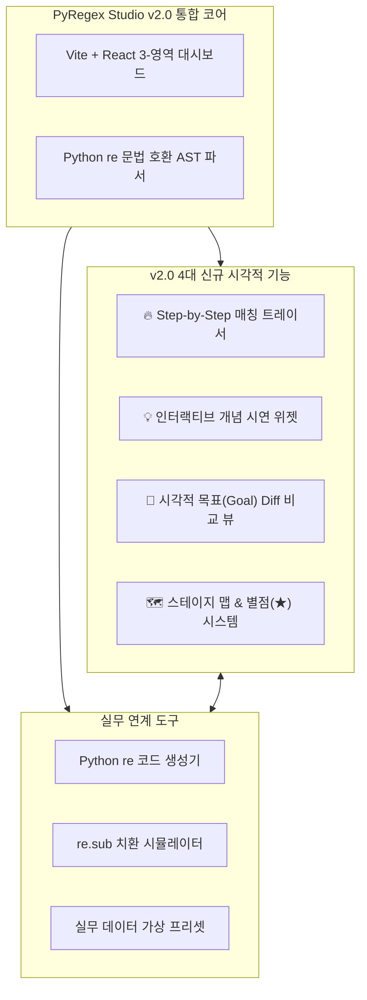
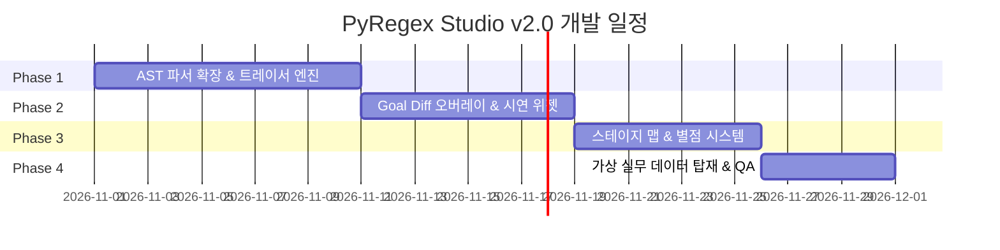

# PyRegex Studio v2.0 개발 계획서 (Implementation Plan v2.0)

> **프로젝트명**: PyRegex Studio (Python `re` 시각적 학습 & 실습 웹 앱 v2.0)  
> **기반 기술**: Vite + React + Tailwind CSS + Python `re` 호환 AST 파서 엔진  
> **핵심 목표**: *Learn Git Branching*의 4대 인터랙티브 UX 강점(매칭 애니메이션, 시연 위젯, 목표 대조 뷰, 별점 스테이지 맵)을 전면 이식하고, PyRegex Studio의 3-영역 대시보드 및 실무 Python 연계성과 통합.

---

## 1. 프로젝트 개요 & v2.0 비전

v1.0에서 확정된 **Vite + React 기반 3-영역 대시보드**와 **Python `re` 특화 기능(코드 생성기, `re.sub` 시뮬레이터, 실무 프리셋)**을 기본 골격으로 유지하면서, *Learn Git Branching* 분석 결과 도출된 **4대 시각적 학습 개선안**을 전면 반영합니다.

---

## 2. 4대 핵심 기능 상세 설계

### ① Step-by-Step 매칭 트레이서 (애니메이션 디버거) 🔥
정규식 엔진이 문자열을 탐색하고 백트래킹(Backtracking)하는 내부 동작 과정을 초단위/스텝별 애니메이션으로 추적합니다.

* **UI 컨트롤 패널**:
  * `[⏮ 처음]` `[◀ 이전]` `[▶ 재생/일시정지]` `[다음 ▶]` `[끝 ⏭]`
  * 슬라이더 및 속도 조절 (0.5x, 1x, 2x)
* **시각화 레이어**:
  * **정규식 토큰 포인터**: 현재 검사 중인 정규식 패턴 단위(`\d+`, `(?P<name>...)` 등) 하이라이트
  * **텍스트 커서 & 인덱스 포인터**: 테스트 문자열 내 현재 위치(`span`) 표시
  * **백트래킹 비주얼 경고**: 매칭 실패 후 되돌아가는 지점에 되감기 애니메이션 및 빨간색 깜빡임 효과 연출
* **특화 학습 포인트**: Greedy(`.+`) vs Lazy(`.+?`)의 탐색 범위 차이, Lookaround(`(?=...)`)의 문자 미소비(Zero-width) 매칭 원리 시각화

---

### ② 인터랙티브 개념 시연(Demo) 위젯 💡
단순 문자에 의존하던 개념 설명을 클릭 한 번으로 실행되는 미니 애니메이션 시연 카드로 교체합니다.

* **위젯 배치**: 각 레슨 좌측 가이드 상단에 **[▶ 시연 보기]** 토글 카드로 배치
* **주요 시연 시나리오**:
  * **Greedy vs Lazy**: `.+`가 문장 전체를 집어삼키는 모습 vs `.+?`가 첫 번째 태그에서 끊어 읽는 모습 연동 시연
  * **명명된 그룹 (`(?P<name>...)`)**: 매칭 텍스트가 Python `groupdict()` 객체 키-값으로 변환되는 과정 애니메이션
  * **전방/후방 탐색 (`Lookaround`)**: 패턴 커서가 이동하지만 텍스트 소비 인덱스는 머물러 있는 모습 시연

---

### ③ 시각적 목표(Goal) 하이라이트 비교 뷰 🎯
학습자가 작성한 정규식 결과와 정답(Goal)의 차이를 텍스트 레이어 위에서 실시간 오버레이로 대조합니다.

* **이중 오버레이 시스템**:
  * **🎯 목표 영역**: 초록색 점선 테두리 (`border: 2px dashed #10B981`)
  * **⚡ 현재 내 매칭**: 노란색/파란색 배경 하이라이트 (`background: #FBBF24`)
* **자동 Diff 진단 피드백**:
  * **과다 매칭 (Over-matching)**: *"목표보다 더 넓게 매칭되었습니다. 탐욕적(Greedy) 수량자를 검토하세요."*
  * **누락 매칭 (Under-matching)**: *"일부 문자가 누락되었습니다. 문자 클래스나 수량자를 확인하세요."*
  * **일치 (Matched)**: *"목표 영역과 100% 일치합니다!"*

---

### ④ 시각적 스테이지 맵 & 최적 해법 별점(★) 시스템 🗺️
*Learn Git Branching*의 성취감 제공 방식을 이식하여 다회차 학습 동기를 강화합니다.

* **월드맵 모달 (`[🗺️ 전체 코스 맵]`)**:
  * Lv 1 ~ Lv 5까지 노드 연결선 형태의 스테이지 맵 구성
  * 각 레슨 아이콘에 완료 상태(미해금, 진행 중, 완료) 및 획득 별점 표시
* **이중 보상 기준**:
  * **일반 클리어 (`✓`)**: 모든 Match / Skip / Group 미션 조건 충족
  * **마스터 별점 (`★`)**: 미션 성공 + (1) 권장 패턴 길이(Par) 이내 작성 + (2) 불필요한 백트래킹 경고 없음

---

## 3. v1.0 기존 기능과의 통합 체계

| 구분 | v1.0 기능 | v2.0 고도화 통합 방안 |
| :--- | :--- | :--- |
| **화면 레이아웃** | 3-영역 대시보드 | 모달을 최소화하고 상단 툴바에 트레이서/목표 대조 컨트롤을 일렬 배치하여 한 화면 직관성 유지 |
| **Python 연계** | `re` Snippet / `re.sub` 시뮬레이터 | 목표 달성(`★` 또는 `✓`) 시 완성된 정규식을 반영한 **Python 복사용 코드** 자동 팝업 연동 |
| **실무 데이터** | 프리셋 및 북마크 | 가상 생성된 **로그 파싱, 마스킹, 추출 샘플 데이터**를 플레이그라운드 및 커리큘럼 실습에 탑재 |

---

## 4. 개발 로드맵 (Phases & Schedule)

* **Phase 1: Step-by-Step 매칭 트레이서 코어 구축 (10일)**
  * 정규식 AST 실행 상태 추적기 및 step-by-step 포인터 인덱싱 엔진 구현
  * 재생/일시정지/스텝 이동 UI 구현
* **Phase 2: Goal Diff 비교 뷰 & 개념 시연 위젯 구현 (8일)**
  * 텍스트 뷰어 상 목표 테두리 vs 현재 하이라이트 오버레이 연동
  * 레슨별 Before/After 미니 애니메이션 시연 카드 10종 제작
* **Phase 3: 시각적 스테이지 맵 & 별점(★) 보상 시스템 구축 (7일)**
  * 월드맵 모달 레이아웃 개발 및 `localStorage` 기반 별점 보관 연동
  * 패턴 길이(Par) 및 백트래킹 판별 평가 로직 구축
* **Phase 4: 가상 실무 예제 데이터 탑재 & 최종 UI/UX 폴리싱 (5일)**
  * 시스템 로그, 보안 마스킹 등 실무 가상 데이터 세트 구축
  * 전체 통합 테스트 및 접근성/성능 최적화

---

## 5. 기대 효과

1. **학습 효과 극대화**: 정규식의 전진/후진/백트래킹 동작을 눈으로 직접 확인하여 오개념 완벽 해소.
2. **높은 몰입감과 동기 부여**: 스테이지 맵과 별점(★) 시스템을 통해 학습 정복감 제공.
3. **실무 즉시 활용**: 현업 데이터를 바탕으로 만든 가상 예제와 Python 코드 자동 생성기로 실무 생산성 향상.
